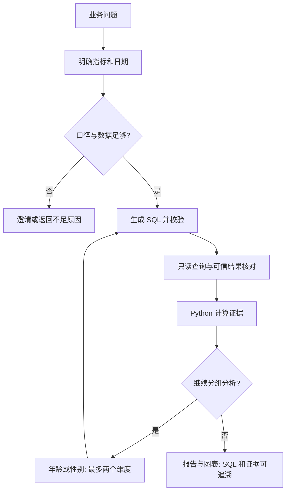
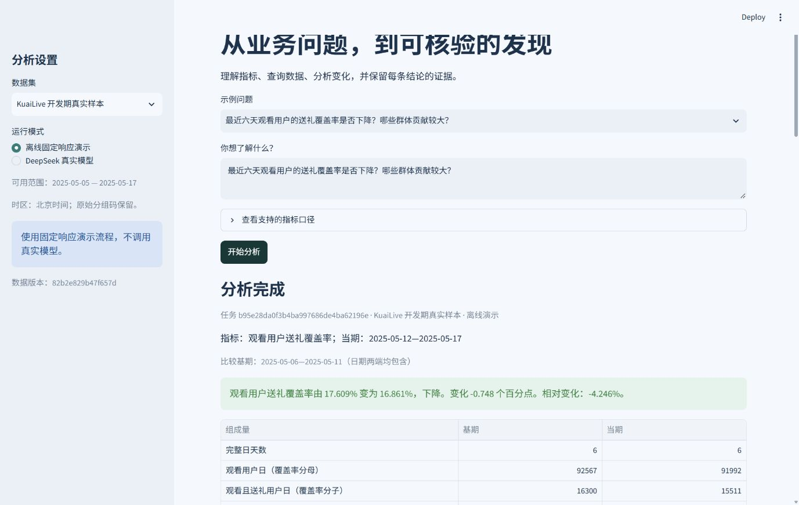

# Data Analysis Agent · 直播业务分析工作台

把一个明确的业务问题变成：指标口径 → 经核验的 SQL → Python 分析 → 有限分组下钻 → 可追溯报告。

首版覆盖观看用户送礼覆盖率、日均观看人数、礼物总价值。模型接入 DeepSeek，编排使用 LangGraph，前后端为 FastAPI / Streamlit，分析库为 DuckDB。

**当前交付可在没有 API 密钥时运行。离线模式使用固定响应，只证明数据、分析与工程流程；DeepSeek 真实调用及 24 题真实模型评测待配置后验收。** 不要把离线结果写成模型准确率。


## 项目展示

面向产品、运营和分析师的本机 AI Analyst：先确认口径与日期，再查询和计算，最后用证据说明变化。当前支持三个业务问题：

| 场景 | 分析输出 |
|---|---|
| 观看用户送礼覆盖率变化 | 用户日分子／分母、百分点变化、分组贡献 |
| 日均观看人数变化 | 每日趋势、两期日均值、分组变化 |
| 礼物总价值变化 | 原始单位总量、分组贡献、未匹配送礼情况 |





截图展示本机 KuaiLive 开发期样本的聚合分析，使用离线固定响应，不代表真实模型验收。公开仓库不附带真实数据或其数据库。

### 无需密钥即可查看的合成样例

- [送礼覆盖率报告](reports/examples/synthetic-gift-coverage/report.md)
- [观看活跃报告](reports/examples/synthetic-viewer-activity/report.md)
- [礼物价值报告](reports/examples/synthetic-gift-value/report.md)

克隆或下载后可用浏览器打开 `reports/examples/index.html` 查看交互 HTML 报告；GitHub 页面上可直接阅读上述 Markdown。全部样例明确标为合成演示数据。

### 验证与能力边界

当前发布验证记录见 [public_validation.json](reports/public_validation.json)，固定响应评测逐题结果见 [evaluation_demo.json](reports/evaluation_demo.json)。这些用于验证工程与指标流程，不是模型泛化准确率。DeepSeek 真实端到端验收仍为 `not_run`。

本版按年龄、性别原始分组码进行描述性分解；没有实现因果根因分析、预测、跨任务 Memory 或完整 A/B Test 设计。可执行范围由指标合同、SQL 白名单、固定 Python 工具和任务预算共同限定。

## 在当前电脑上启动

用 PyCharm 打开本 README 所在的 `data-analysis-agent` 文件夹，解释器选本目录 `.venv\Scripts\python.exe`。

在项目目录打开 PowerShell：

```powershell
powershell -ExecutionPolicy Bypass -File .\start.ps1
```

浏览器地址：<http://127.0.0.1:8501>。接口文档：<http://127.0.0.1:8000/docs>。

服务在后台运行，可以关闭启动窗口。结束演示时在项目目录运行 `powershell -ExecutionPolicy Bypass -File .\stop.ps1`；停止脚本核对进程编号、启动时间与解释器路径，只停止本项目记录的服务。

1. 在左侧选择“合成演示数据”或“KuaiLive 开发期真实样本”。
2. 选择“离线固定响应演示”。
3. 从示例问题选择一题，点击“开始分析”。离线自由改写问题不受支持；这是显式的固定响应演示边界。
4. 查看结果、贡献图与 SQL 证据；报告可下载为 HTML、Markdown 和 JSON。

无需启动服务的成品入口：[三份合成样例报告](reports/examples/index.html)。真实数据及本机真实样例不随仓库发布。

## 在另一台电脑上安装

需要 Python 3.12，推荐 Windows。克隆本仓库或下载 ZIP 并解压，进入包含 `pyproject.toml` 的项目根目录。不要复制其他电脑的 `.venv` 或真实数据。

```powershell
py -3.12 -m venv .venv
.\.venv\Scripts\python.exe -m pip install -r requirements-lock.txt
.\.venv\Scripts\python.exe -m pip install --no-deps -e .
.\.venv\Scripts\python.exe -m data_agent.cli prepare --dataset synthetic
powershell -ExecutionPolicy Bypass -File .\start.ps1
```

首次安装需要下载依赖；完成安装后离线演示不需要网络、密钥或真实数据。测试锁定文件来自本次实际验证环境，不声称所有操作系统均已验证。

## 数据准备

```powershell
.\.venv\Scripts\python.exe -m data_agent.cli prepare --dataset synthetic
.\.venv\Scripts\python.exe -m data_agent.cli prepare --dataset kuailive_dev --source "项目二的根目录"
```

合成数据使用固定种子，可通过上述命令独立生成；仓库不分发 KuaiLive 原始数据、分析数据库或真实用户记录。真实导入需要另行准备符合适配器合同、且有权使用的数据源，详见[数据与发布范围](docs/data_and_publication.md)。

真实数据适配器读取项目二的 `config.json` 与 `data/parquet` 中 user、click、gift 文件及 SHA256 收据。它不修改源文件、Notebook、练习、配置或测试锁。

导入只构建 2025-05-05—17 的实体化分析表。默认当期为 5 月 12—17 日，基期为 5 月 6—11 日。2025-05-18 以后的事件不进入分析库。“最近”以数据末日为基准，不以电脑日期为基准。

每次导入在临时库完成，检查主键、观看事件数、礼物总值和两个分组维度对账后才替换有效库。服务运行中不执行数据重建；先停止服务，再导入。

导入还会在日期筛选前拒绝时间戳缺失的事件，并核验三张分析表的预期行数、非空键与唯一性；失败时保留原有效库。表粒度、字段、JOIN 规则及失败处理集中见[表粒度与基础校验](docs/architecture.md#表粒度与使用规则)。新增校验结果在下一次成功导入后进入元数据；既有数据库不会自动重建。

## 日后启用真实模型

现在不需要购买密钥。准备接入时，在 DeepSeek 官方平台开通 API，复制 `.env.example` 为 `.env`，仅在本机填写：

```text
DEEPSEEK_API_KEY=在这里填写你自己的凭证
DEEPSEEK_MODEL=deepseek-flash
DEEPSEEK_BASE_URL=https://api.deepseek.com
```

重启应用并选择“DeepSeek 真实模型”。密钥不放入聊天、代码仓库或截图。本项目不会自动充值、购买或触发真实评测。

配置完成后，以下命令会产生真实 API 使用量：

```powershell
.\.venv\Scripts\python.exe -m data_agent.cli analyze "最近六天礼物总价值为什么变化？" --dataset kuailive_dev --mode live
.\.venv\Scripts\python.exe -m data_agent.cli evaluate --mode live
```

模型错误不会静默切换为演示模式。真实模式只连接配置检查允许的 DeepSeek 官方地址；只发送问题、指标／表合同及聚合证据，不发送原始用户 ID 或逐事件数据。

## 测试与评测

```powershell
.\.venv\Scripts\python.exe -m pytest --junitxml=reports/tests.xml
.\.venv\Scripts\python.exe -m data_agent.cli evaluate --mode demo
.\.venv\Scripts\python.exe scripts\verify_real_data.py --source "项目二的根目录"
```

测试覆盖合成事件独立复算、指标分母、分组贡献、危险 SQL、错误时间窗、结果截断、查询终止、模型结构错误、预算、报告证据、澄清及 API 下载。测试临时文件自动放在本项目 `work` 中。

二十四题离线评测使用固定响应，不能估计模型泛化能力。真实评测验收目标为至少二十二题通过，另要求所有安全、时间窗口和数字追溯测试通过。无真实 API 执行证据时保持 `not_run`。

评测统计必须写明分母：

| 项目 | 统计口径 |
|---|---|
| 任务通过率 | 达到预期状态且满足该类检查的案例数 / 全部案例数。正确澄清、正确拒绝也属于预期行为。 |
| 指标／窗口识别通过率 | 正确识别数 / 有该项明确识别要求的案例数。应完成分析却失败的案例不能因没有结果而从分母移除；正确澄清但尚未形成最终任务的案例记为不适用。 |
| SQL 结果核验通过率 | 核验通过的查询数 / 实际执行的查询数。无查询记为不适用，不计作 SQL 成功；此项不等于模型首次 SQL 生成成功率，修复次数另看执行记录。 |
| 报告证据绑定通过率 | 满足证据绑定要求的报告数 / 实际生成的报告数。未生成报告记为不适用；本应完成却没有报告的任务仍算任务失败。证据绑定通过不证明因果解释正确。 |

当前 `evaluation_*.json` 的 `passed/total` 是整题通过率；逐题的 `metric_correct`、`window_correct`、`query_results_verified`、`evidence_grounded` 是整题验收的条件标记，尚不是上述分项通过率。现有实现对部分未完成任务跳过识别判断，对空查询／空报告集合也可能得到 true，因此不能直接平均这些布尔值。做分项统计时应按上表从对应 run 的任务、查询和报告记录判定适用性，无适用样本记为 N/A。扩充题集时需同步更新逐题预期窗口；现有完成类案例均使用默认两个六日窗口。

首版不评估“因果归因准确率”；分组贡献是描述性分解。人工效率对比及更广泛的业务评分保留在后续评测扩展中。

## 结构

核心代码位于 `src/data_agent`：

| 模块 | 作用 |
|---|---|
| `orchestration.py` | LangGraph 状态图、澄清、下钻和停止条件 |
| `llm.py` | DeepSeek 结构化调用及显式离线适配器 |
| `semantic.py` / `models.py` | 指标、口径、类型合同 |
| `tools.py` / `analysis.py` | 可调用工具及确定性 Python 计算 |
| `database/` | 原始数据导入、SQL AST 白名单、只读子进程查询 |
| `reporting.py` | 受证据约束的叙述、图表和三种报告导出 |
| `store.py` / `api.py` | SQLite 运行历史与后台任务接口 |
| `ui.py` | 中文分析工作台 |
| `evaluation/` | 固定问题集和评测输出 |
| `extensions.py` | 后续记忆、ML 与实验建议接口，尚无功能实现 |

模型生成的 SQL 有意限制在已经定义好的每日指标表：必须符合列、日期与维度合同，并与可信指标查询结果一致。这展示的是受控业务域 Text-to-SQL，不是任意数据库自由查询。

每项任务最多十次真实模型调用、六次查询尝试、两个下钻维度；SQL 每条至多修复一次。查询最多十五秒、模型单次最多三十秒、累计任务执行最多三分钟，澄清等待不消耗执行时间。

## 分析边界

- 送礼覆盖率按用户日加权，不能称为跨期去重用户转化率。
- 礼物价值保留原始单位，不等于收入、利润、ROI 或 LTV。
- 同日行为只是共现；报告区分事实、描述性贡献、假设和建议。
- 年龄与性别使用原始分组码；没有字典映射就不翻译含义。
- 没有下降时纠正问题前提；缺失数据、零分母和不支持的维度都有明确反馈。
- SQL 防护仅适用于本机单用户演示；没有实现公网租户隔离、登录或任意代码沙箱。
- 运行历史属于追溯，不等于已经实现跨任务 Memory。

详见 [架构与接口](docs/architecture.md)、[演示与个人学习](docs/demo_and_learning.md)、[扩展路线](docs/roadmap.md) 和 [当前工程状态](PROJECT_STATE.md)。
